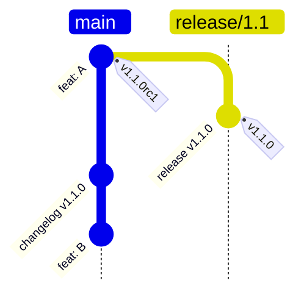
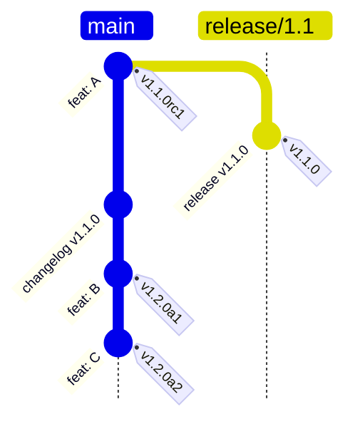
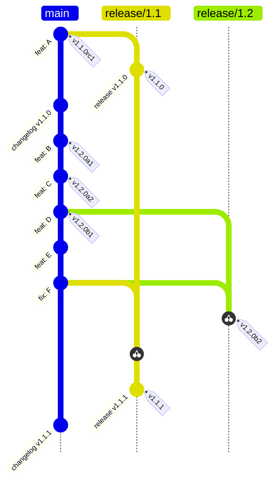
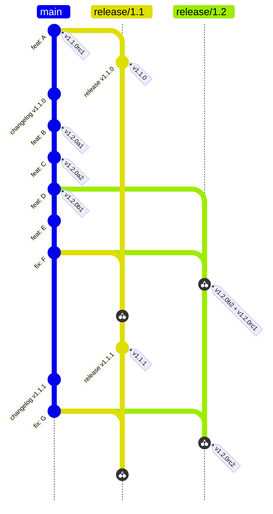
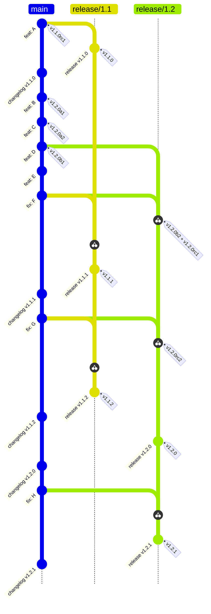

# Branching model

`release/X.Y` is created at the feature freeze: the first beta, or the first release
candidate when there are no betas. Alphas never create a branch. Each step below is the
same history, later.

**1. v1.1.0 is out.** `release/1.1` was cut at `v1.1.0rc1`; merging its release PR tagged
`v1.1.0`, and the changelog was copied back to `main`. Features keep landing on `main`.

**2. Alphas.** *Release, minor, alpha* tags `main`'s HEAD; each rerun tags the next alpha.
No branch, no release PR. Features keep landing.

**3. Beta: the feature freeze.** *Release, minor, beta* cuts `release/1.2` at `main`'s HEAD
and tags `v1.2.0b1`; the release PR opens as a draft. `feat: E` lands on `main` after the
freeze, so it waits for 1.3. `fix: F` gets the `backport` label: because 1.2 is in
pre-release, it goes to **both** lines, tagging `v1.2.0b2` and updating the `v1.1.1`
release PR, which a maintainer merges.

**4. Release candidates.** *Release, minor, rc* promotes 1.2: it tags `v1.2.0rc1` on the
branch HEAD (the same commit as `v1.2.0b2`) and marks the release PR ready. The next
backport, `fix: G`, tags `v1.2.0rc2` and still reaches 1.1 (pending `v1.1.2`).

**5. Final and patches.** The pending `v1.1.2` is merged, then the 1.2 release PR, which
tags `v1.2.0`. From now on 1.1 is unsupported and backports go to `release/1.2` only:
`fix: H` updates the `v1.2.1` release PR, and merging it ships the patch, with no
pre-releases.

The diagrams leave out the bot's `release-pr/X.Y`, `changelog/vX.Y.Z` and backport
branches, and the commits that record the version for pre-release tags when a repository
has version files.
