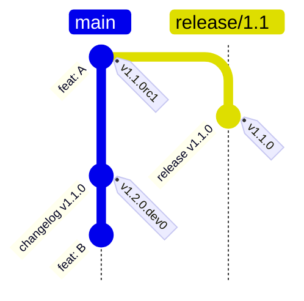
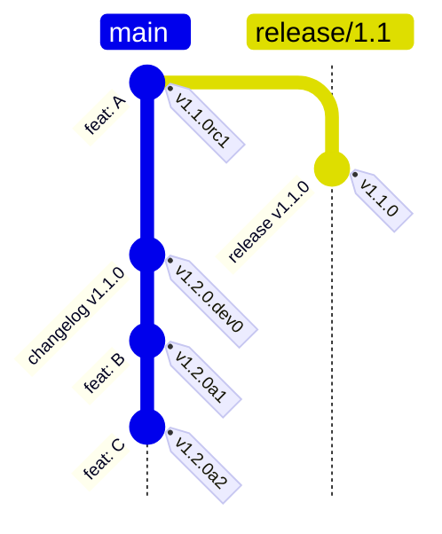
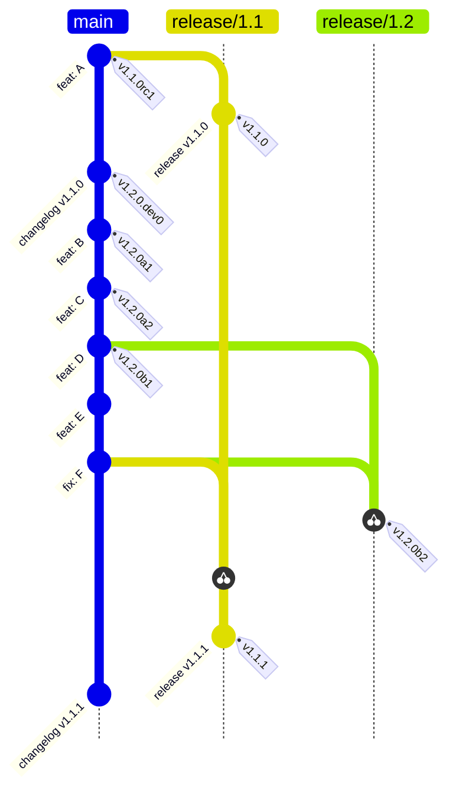
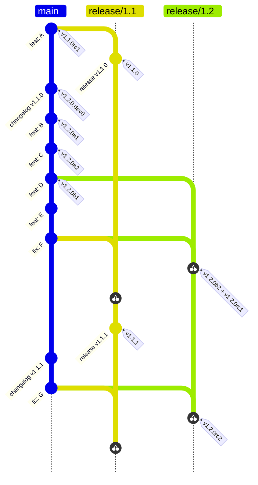
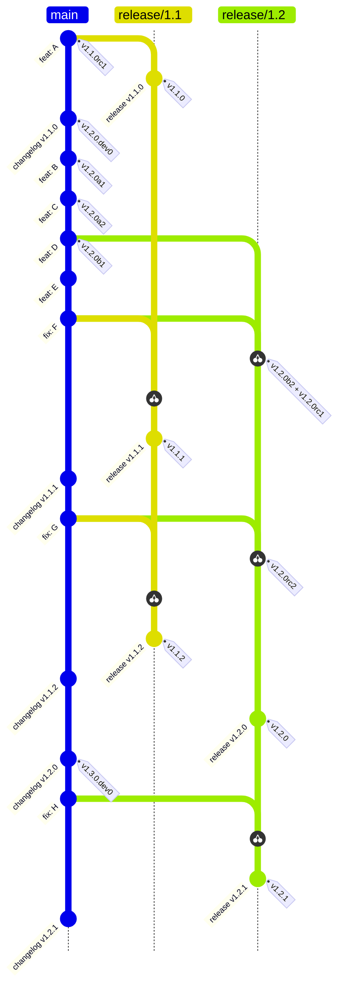

# Branching model

`release/X.Y` is created at the feature freeze: the first beta, or the first release
candidate when there are no betas. Alphas never create a branch. Each step below is the
same history, later.

**1. v1.1.0 is out.** `release/1.1` was cut at `v1.1.0rc1`; merging its release PR tagged
`v1.1.0`, and the changelog was copied back to `main`. Features keep landing on `main`.
The bot tags the changelog commit `v1.2.0.dev0`, and writes that version into `main`'s
version files if the repository has any: `v1.1.0` is never in `main`'s history, so without
it versions derived from `main` (setuptools-scm, hatch-vcs, copier) would sort below
`v1.1.0`. The tag is a development marker, not a release: nothing publishes it.

**2. Alphas.** *Release, minor, alpha* tags `main`'s HEAD; each rerun tags the next alpha.
No branch, no release PR. Features keep landing.

**3. Beta: the feature freeze.** *Release, minor, beta* cuts `release/1.2` at `main`'s HEAD
and tags `v1.2.0b1`; the release PR opens as a draft. `feat: E` lands on `main` after the
freeze, so it waits for 1.3. `fix: F` gets the `backport` label: because 1.2 is in
pre-release, it goes to **both** lines, tagging `v1.2.0b2` and updating the `v1.1.1`
release PR, which a maintainer merges.

**4. Release candidates.** *Release, minor, rc* promotes 1.2: it tags `v1.2.0rc1` on the
branch HEAD (the same commit as `v1.2.0b2`) and marks the release PR ready. The next
backport, `fix: G`, tags `v1.2.0rc2` and still reaches 1.1 (pending `v1.1.2`).

**5. Final and patches.** The pending `v1.1.2` is merged, then the 1.2 release PR, which
tags `v1.2.0`. From now on 1.1 is unsupported and backports go to `release/1.2` only:
`fix: H` updates the `v1.2.1` release PR, and merging it ships the patch, with no
pre-releases.

The diagrams leave out the bot's `release-pr/X.Y`, `changelog/vX.Y.Z` and backport
branches, and the commits that record the version for pre-release tags when a repository
has version files.

## Versions of `main`

A development build of `main` is, for example, a nightly build,
`pip install git+…@main`, or an editable install. This build finds its version in one of two locations:

- the nearest `v*` tag in the history of `main` (setuptools-scm, hatch-vcs,
  `git describe`, copier);
- the version files, with `version-files`.

These two locations do not contain the versions of the release line. The final tags are
only on `release/X.Y`. The betas and the release candidates after the freeze are also only
on `release/X.Y`. With version files, each pre-release tag points to a commit that is not
on `main`. This commit records the version, and the bot does not push it to a branch.

Thus, after each `X.Y.0`, the bot changes `main` to the next series. It tags the commit
that the changelog PR adds to `main` with `vX.(Y+1).0.dev0`. It also writes this version
into the version files.

A `.dev` version is a pre-release, and nothing publishes it. It is lower than each alpha,
beta and release candidate of its version. It is higher than each release before it:
`1.1.2 < 1.2.0.dev0 < 1.2.0a1`. The tag identifies the next minor release, because the bot
cannot know if the next release is a major release. The order stays correct:
`1.2.0.dev0` is also lower than `2.0.0a1`.

The table shows the version of `main` at each step of the history above. For versions from
tags, the table uses setuptools-scm, one or two commits after the newest tag in the
history of `main`.

| Step | Newest release of the line | `main`, version from tags | `main`, version files |
| --- | --- | --- | --- |
| 1. `v1.1.0` is out | `1.1.0` | `1.2.0.dev1`: higher | `1.2.0.dev0`: higher |
| 2. Alphas | `1.2.0a2` | `1.2.0a3.dev1`: higher | `1.2.0.dev0`: **lower** |
| 3. Beta, the freeze | `1.2.0b2` | `1.2.0b2.dev1`: **lower** | `1.2.0.dev0`: **lower** |
| 4. Release candidates | `1.2.0rc2` | `1.2.0b2.dev2`: **lower** | `1.2.0.dev0`: **lower** |
| 5. `v1.2.0` and its patches | `1.2.1` | `1.3.0.dev1`: higher | `1.3.0.dev0`: higher |

### Known problems

- **Versions from tags, during the freeze.** From the cut of `release/X.Y` to `X.Y.0`,
  `main` shows `X.Y.0b2.devN` or `X.Y.0rcN.devM`. This version is lower than the betas,
  release candidates and final release of the release line, but `main` contains newer
  work. The version also identifies the wrong series: changes that merge after the freeze
  go into `X.(Y+1)`. The bot does not tag `main` at the cut. The commit at the cut is the
  start of `release/X.Y`. Thus, a tag on this commit also changes the versions of the
  release line.
- **Version files, during the full cycle.** This problem applies to a build that reads its
  version from the version files. Usually, this is a build without git metadata, for
  example a Nix derivation (refer to [Adopting release-tools](adopting.md)). Builds that
  can read the tags do not have this problem.
  - On `main`, the build shows `X.(Y+1).0.dev0` from `X.Y.0` to `X.(Y+1).0`. This version
    is lower than each alpha, beta and release candidate of that series.
  - On `release/X.Y`, the build shows the value that the files had at the cut, until the
    final release. After the final release, it shows the newest final release. This
    version does not change when backports merge.
  - Only a commit can change the files. The bot makes such a commit only in a release PR
    or in the changelog PR.
- **A changelog PR that does not merge immediately.** The tag goes on the commit that the
  PR adds to `main`. If the bot cannot merge the PR immediately, the job shows a warning.
  `main` then stays lower than `X.Y.0` until one of these events occurs:
  - the next alpha;
  - the PR merges, and you start the "Release" run of the job again.
- **Major releases.** Until the first pre-release of a major release, its development
  version identifies a minor release. The order is correct, but the number is not.

These problems apply only to the versions of `main`, and nothing publishes these
versions. The problems are important when a build of `main` must agree with a release.
For example, a test environment can require `>=` the latest release candidate. Refer to
[Open questions](open-questions.md) for possible solutions.
