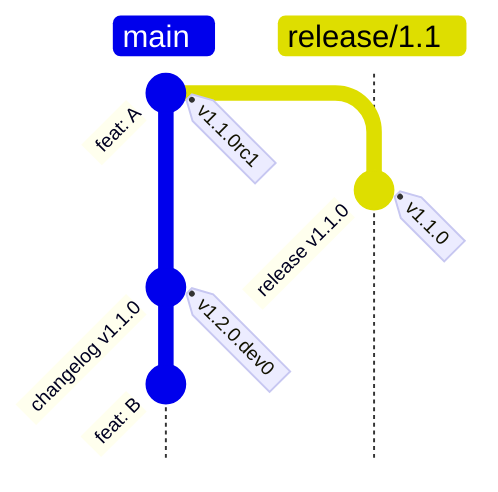
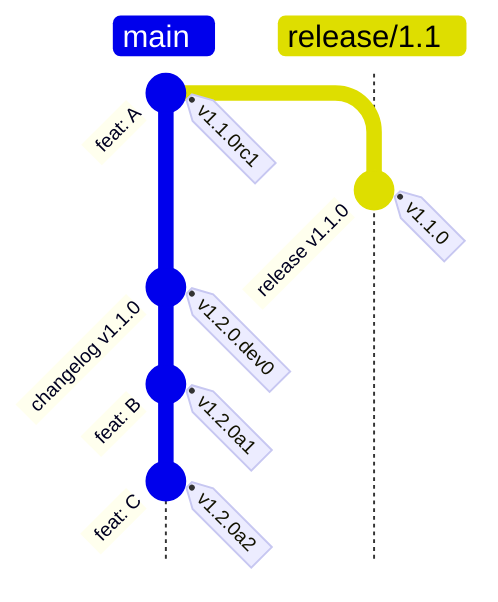
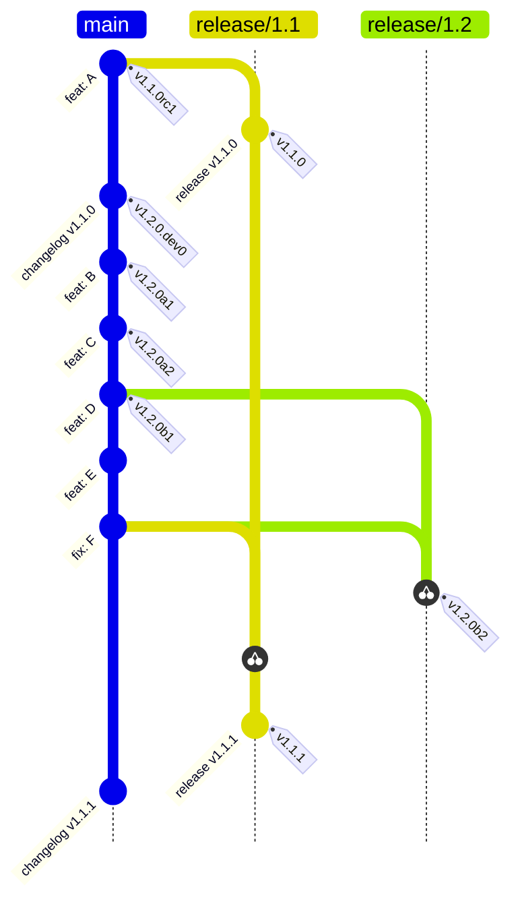
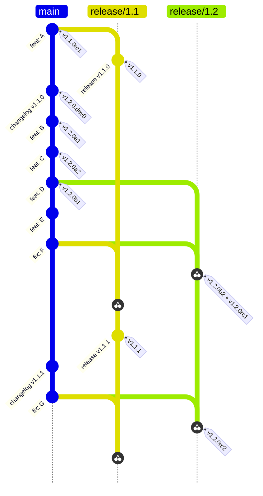
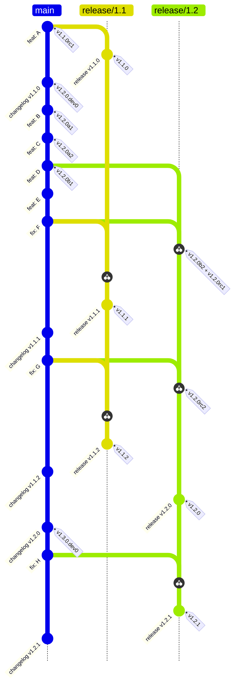

# Branching model

`release/X.Y` is created at the feature freeze: the first beta, or the first release
candidate when there are no betas. Alphas never create a branch. Each step below is the
same history, later.

**1. v1.1.0 is out.** `release/1.1` was cut at `v1.1.0rc1`; merging its release PR tagged
`v1.1.0`, and the changelog was copied back to `main`. Features keep landing on `main`.
The bot tags the changelog commit `v1.2.0.dev0`, and writes that version into `main`'s
version files if the repository has any: `v1.1.0` is never in `main`'s history, so without
it versions derived from `main` (setuptools-scm, hatch-vcs, copier) would sort below
`v1.1.0`. The tag is a development marker, not a release: nothing publishes it.

**2. Alphas.** *Release, minor, alpha* tags `main`'s HEAD; each rerun tags the next alpha.
No branch, no release PR. Features keep landing.

**3. Beta: the feature freeze.** *Release, minor, beta* cuts `release/1.2` at `main`'s HEAD
and tags `v1.2.0b1`; the release PR opens as a draft. `feat: E` lands on `main` after the
freeze, so it waits for 1.3. `fix: F` gets the `backport` label: because 1.2 is in
pre-release, it goes to **both** lines, tagging `v1.2.0b2` and updating the `v1.1.1`
release PR, which a maintainer merges.

**4. Release candidates.** *Release, minor, rc* promotes 1.2: it tags `v1.2.0rc1` on the
branch HEAD (the same commit as `v1.2.0b2`) and marks the release PR ready. The next
backport, `fix: G`, tags `v1.2.0rc2` and still reaches 1.1 (pending `v1.1.2`).

**5. Final and patches.** The pending `v1.1.2` is merged, then the 1.2 release PR, which
tags `v1.2.0`. From now on 1.1 is unsupported and backports go to `release/1.2` only:
`fix: H` updates the `v1.2.1` release PR, and merging it ships the patch, with no
pre-releases.

The diagrams leave out the bot's `release-pr/X.Y`, `changelog/vX.Y.Z` and backport
branches, and the commits that record the version for pre-release tags when a repository
has version files.

## Versions derived from `main`

A development build of `main` (a nightly, `pip install git+…@main`, an editable install)
gets its version one of two ways: from the nearest `v*` tag in `main`'s history
(setuptools-scm, hatch-vcs, `git describe`, copier), or from the version files, with
`version-files`. Neither sees the release line: final tags, and the betas and release
candidates after the freeze, are on `release/X.Y` only, and with version files every
pre-release tag points to a commit off `main` that records its version, so that no branch
is ever pushed to.

So after each `X.Y.0` the bot moves `main` on to the next series: it tags the commit that
the changelog PR adds to `main` `vX.(Y+1).0.dev0` and writes that version into the
version files. A `.dev` version is a pre-release that sorts below every alpha, beta and
release candidate of its version, and above every release before it
(`1.1.2 < 1.2.0.dev0 < 1.2.0a1`), and nothing publishes it. It names the next minor,
because the bot cannot know whether the next release will be a major one; it still sorts
below `2.0.0a1`.

What `main` reports along the history above (version from tags: setuptools-scm, a
commit or two after the newest tag in `main`'s history):

| Step | Newest release of the line | `main`, version from tags | `main`, version files |
| --- | --- | --- | --- |
| 1. `v1.1.0` is out | `1.1.0` | `1.2.0.dev1`: above | `1.2.0.dev0`: above |
| 2. Alphas | `1.2.0a2` | `1.2.0a3.dev1`: above | `1.2.0.dev0`: **below** |
| 3. Beta, the freeze | `1.2.0b2` | `1.2.0b2.dev1`: **below** | `1.2.0.dev0`: **below** |
| 4. Release candidates | `1.2.0rc2` | `1.2.0b2.dev2`: **below** | `1.2.0.dev0`: **below** |
| 5. `v1.2.0` and its patches | `1.2.1` | `1.3.0.dev1`: above | `1.3.0.dev0`: above |

### What this leaves open

- **The freeze window, for versions from tags.** From the cut of `release/X.Y` to
  `X.Y.0`, `main` reports `X.Y.0b2.devN` or `X.Y.0rcN.devM`: below the release line's own
  betas, release candidates and final, though it holds newer work, and it names the
  series that `main` no longer develops (what lands after the freeze goes into
  `X.(Y+1)`). The bot doesn't tag `main` at the cut: the commit it would tag is where
  `release/X.Y` starts, so the tag would reach the release line's versions too.
- **The whole cycle, for version files.** A build that reads its version from the version
  files, in practice one without git metadata such as a Nix derivation ([Adopting
  release-tools](adopting.md)), sees `X.(Y+1).0.dev0` on `main` from `X.Y.0` to
  `X.(Y+1).0`: below every alpha, beta and release candidate of that series. On
  `release/X.Y` it sees the value the files had at the cut until the final, and the
  newest final after it, also once backports have landed. Only a commit changes the
  files, and the bot makes one only in a release PR or the changelog PR; builds that see
  the tags don't have this gap.
- **A changelog PR that doesn't merge at once.** The tag goes on the commit the PR adds
  to `main`. If the bot can't merge it at once, the job warns, and `main` stays below
  `X.Y.0` until the PR merges and the job's "Release" run is re-run, or until the next
  alpha.
- **Major releases** are named as minors until their first pre-release: the order is
  right, the number is not.

Only versions of `main` are affected: nothing publishes them. They matter where a build
of `main` meets a release, for example a test environment that requires `>=` the latest
release candidate. See [Open questions](open-questions.md) for the ways to close them.
